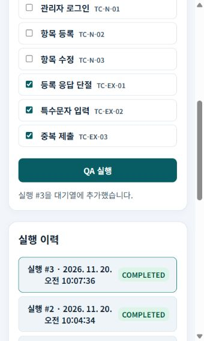

# Admin QA Automation Bot

관리자가 항목을 등록·조회·수정하고, QA 대시보드에서 Playwright 시나리오를 실행하는 로컬 앱입니다. FastAPI와 SQLite가 관리 데이터 및 QA 이력을 보관하고, 별도 Worker가 각 테스트를 전용 DB와 loopback 앱에서 실행합니다.

대시보드에서 **항목 등록**을 고르고 실행하면 Worker가 브라우저를 열어 로그인하고, 테스트 항목을 등록한 뒤 화면 표시와 DB 저장 건수를 확인합니다. 확인 결과로 `PASS` 또는 `FAIL`을 기록하고 로그와 스크린샷을 자동으로 남깁니다.

## PowerShell에서 직접 검증한 장애 3종

2026년 11월 20일, PowerShell에서 같은 Playwright 테스트를 **결함 조건과 복구 조건으로 각각 직접 실행**했습니다. 실행마다 별도의 임시 DB를 사용했습니다. 결함 조건에서 기대한 실패 **3/3건**, 복구 조건에서 통과 **3/3건**을 확인했습니다.

| 시나리오 | 결함 조건에서 확인한 실패 | 같은 테스트의 복구 결과 |
| --- | --- | --- |
| TC-EX-01 등록 응답 단절 | 첫 등록이 끝난 뒤 브라우저 응답을 끊었습니다. 새 키로 재시도하자 HTTP 201이 반환되고 DB에 2건이 저장됐습니다. `1 failed` | 응답을 같은 방식으로 끊고 같은 키로 재시도했습니다. HTTP 200과 최초 항목 ID가 반환됐고 DB에는 1건이 저장됐습니다. `1 passed` |
| TC-EX-02 특수문자 입력 | 입력한 꺾쇠가 빠져 API 응답·DB·브라우저에서 모두 원문과 달랐습니다. `1 failed` | 같은 입력을 제출한 뒤 세 곳 모두 원문과 일치했습니다. `1 passed` |
| TC-EX-03 중복 제출 | 같은 요청 10건을 동시에 보내자 서로 다른 ID 10개가 반환되고 DB에 10건이 저장됐습니다. `1 failed` | 동시 요청 10건이 모두 같은 ID를 반환했고 DB에는 1건이 저장됐습니다. `1 passed` |

결함 조건의 `1 failed`는 문제가 재현됐다는 증거입니다.

## QA 대시보드 실행 #3

2026년 11월 20일 10:07 KST에 대시보드에서 장애 시나리오 3종을 선택해 실행했습니다. 격리된 테스트 DB에서 복구 동작을 확인했고, 실행 상태는 `COMPLETED`, 개별 판정은 **3/3 PASS**였습니다.

| 시나리오 | 판정 | 확인한 동작 | 스크린샷 |
| --- | --- | --- | --- |
| TC-EX-01 등록 응답 단절 | `PASS` · 929 ms | 서버가 등록을 마친 뒤 브라우저 응답을 끊었습니다. 같은 키로 재시도하자 HTTP 200과 최초 항목 ID가 반환됐고, DB에는 1건만 남았습니다. | [재시도 후 목록](docs/evidence/run-3/TC-EX-01.png) |
| TC-EX-02 특수문자 입력 | `PASS` · 699 ms | 한글·따옴표·앰퍼샌드·꺾쇠가 들어간 입력이 API 응답, DB, 브라우저 표시에서 모두 원문과 일치했습니다. | [원문 표시](docs/evidence/run-3/TC-EX-02.png) |
| TC-EX-03 중복 제출 | `PASS` · 890 ms | 등록 버튼을 10번 연속 누르는 경우와 같은 키로 요청 10건을 동시에 보내는 경우 모두 테스트 DB에 1건만 저장됐습니다. 동시 요청은 모두 같은 항목 ID를 반환했습니다(HTTP 201 1건, HTTP 200 9건). | [빠른 클릭 후 목록](docs/evidence/run-3/TC-EX-03.png) |

Worker 로그에는 판정 근거와 동일 키로 다른 본문을 제출했을 때의 HTTP 409 응답이 포함되어 있습니다. [공개용 Worker 로그](docs/evidence/run-3/worker-log.txt) · [판정 JSON](docs/evidence/run-3/results.json)

